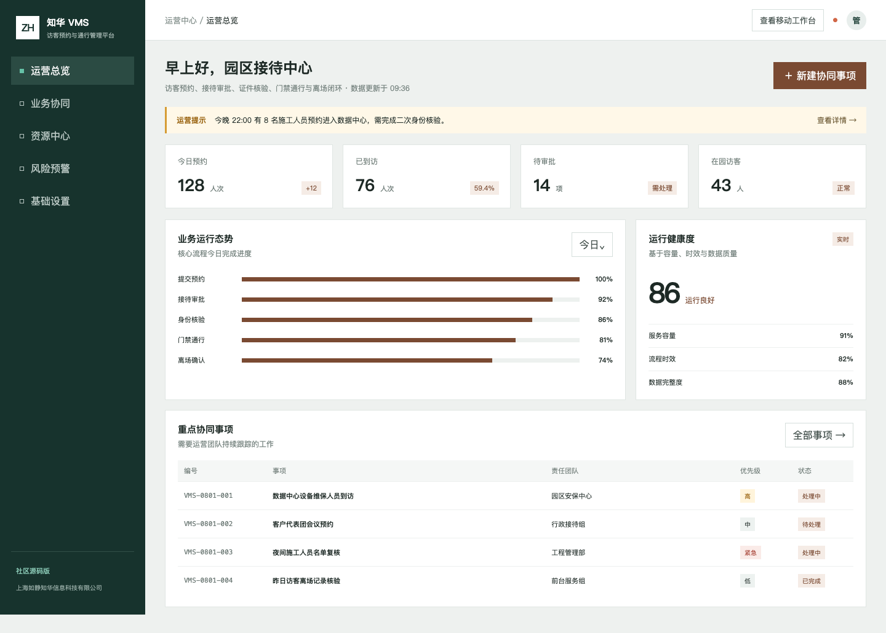
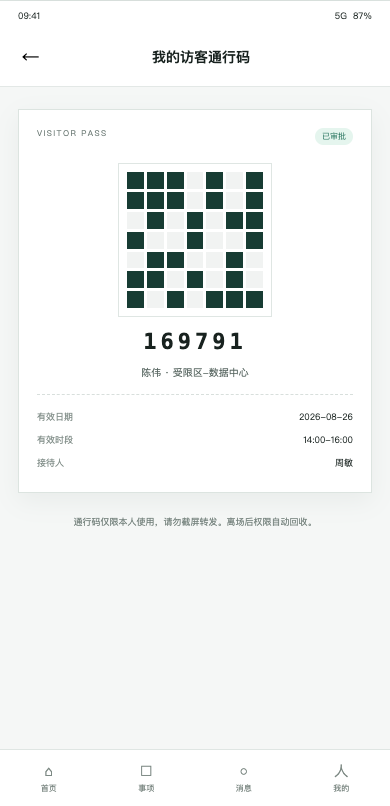
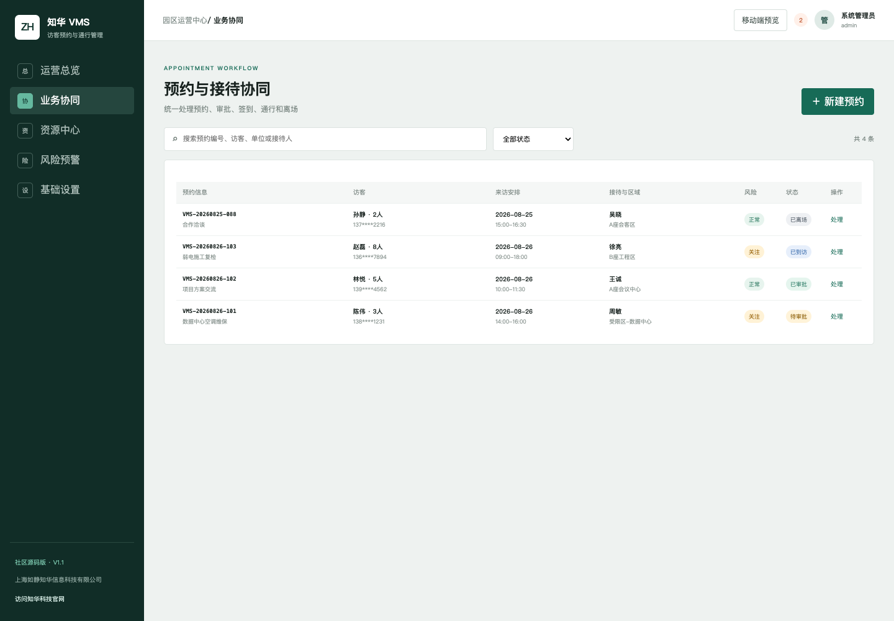
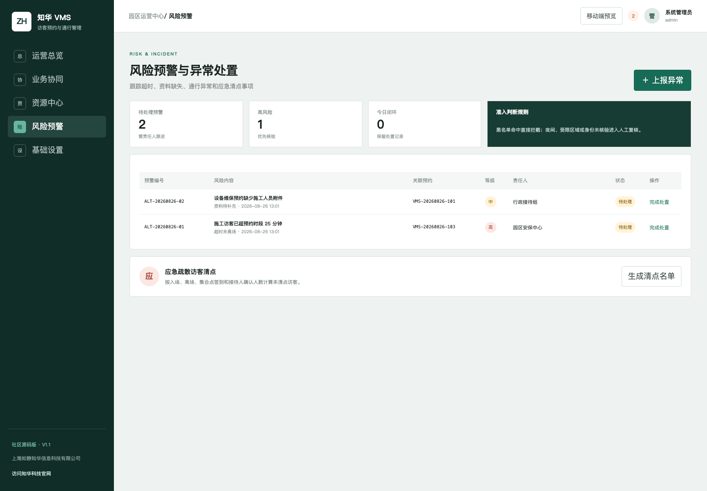

[简体中文](README.md) | **English**

## Operational review workspace

This release adds an authenticated, structured batch workspace at `/operations.html`, backed by project-specific deterministic calculations, explicit validation, explainable decisions, and CSV/JSON exports. Decimal values are preserved exactly; no external model call is made.

Results are **read-only decision support**, not approvals or posted transactions. The feature does not send payments, sign contracts, destroy records, or control devices, and does not certify the whole application for production. See [the calculation contract and API guide](docs/OPERATIONS-REVIEW.md).

# ZhuaTech Visitor Management System

> A source-available enterprise project by [ZhuaTech](https://www.zhuatech.cn/) for visitor invitation, access, reception, and on-site security management.

ZhuaTech Visitor Management System provides a practical, self-hosted foundation for visitor invitation, access, reception, and on-site security management. It is designed for reception teams, security teams, employees, visitors, and site administrators, with clear business records, controlled workflows, operational visibility, and auditable actions.

This repository is intended for learning, technical evaluation, and non-commercial collaboration. The included implementation, tests, database resources, and container configuration provide a reproducible starting point for further enterprise adaptation.

**Search topics:** enterprise visitor management system, self-hosted visitor management system, Java Spring Boot enterprise software, digital transformation.

## Solution Overview

- **Primary users:** Reception teams, security teams, employees, visitors, and site administrators.
- **Deployment model:** Self-hosted, with container-based local deployment where supported.
- **Governance baseline:** Role-aware operations, validation, approval boundaries, exception handling, and auditability.
- **Production boundary:** Review security, identity, backup, observability, capacity, and compliance controls before production use.

## Business Coverage

- **Visitor invitations and appointments** — Manage visitor invitations and appointments with ownership, validation, and explicit lifecycle states.
- **Identity and access verification** — Coordinate identity and access verification through controlled workflows and approval gates.
- **Reception check-in and passes** — Track reception check-in and passes metrics, exceptions, deadlines, and follow-up actions.
- **Watchlists and risk alerts** — Preserve watchlists and risk alerts evidence in searchable, traceable operational history.
- **Visit lifecycle and notifications** — Expose visit lifecycle and notifications in role-aware user and administration workspaces.
- **Reception analytics and audit evidence** — Connect reception analytics and audit evidence to external systems through configurable integration boundaries.

## Implementation Stack

**Technology stack:** Java 21 · Spring Boot · Vue 3 · Vite · MySQL 8 · Docker Compose

### Repository Layout

- `backend/` — Java backend, domain services, APIs, validation, and automated tests
- `frontend/` — responsive user and administration interfaces
- `docs/` — architecture, operations, screenshots, and supporting documentation
- `scripts/` — repeatable local validation and maintenance scripts
- `compose.yaml` — local multi-service orchestration

## Local Deployment

```bash
docker compose up -d --build
```

- Review `compose.yaml` before changing published ports, storage paths, or production credentials.

## Verification

Run the checks supported by this repository before changing or deploying it:

```bash
cd backend && mvn test
cd frontend && npm ci && npm run build
```

## Interface Preview

### Vms Reception Dashboard



### Vms Mobile Pass



### Vms Appointment Workflow



### Vms Risk Alerts



## Security and Production Readiness

- Never commit real passwords, API keys, tokens, certificates, customer data, or production connection strings.
- Replace all local demonstration credentials and secrets before deployment.
- Apply least privilege, tenant isolation, backup and restore drills, monitoring, rate limiting, and vulnerability management.
- Please report security issues privately through the contact channels below instead of publishing sensitive details.

## Usage and Commercial Licensing

Copyright © 2026 Shanghai Rujing Zhihua Information Technology Co., Ltd.

This project is a publicly available source edition intended solely for personal learning, technical research, and non-commercial communication. Commercial use, paid delivery, resale, hosted commercial services, and commercial derivative distribution require prior written authorization from the copyright holder.

Third-party dependencies remain subject to their respective licenses. Review the repository `LICENSE` and `NOTICE` files before use.

## Commercial Licensing and Enterprise Services

For commercial licensing, private deployment, enterprise customization, software outsourcing, implementation services, FDE outsourcing, OPC technical support, or AI transformation consulting, contact ZhuaTech:

- Email: [han@zhuatech.cn](mailto:han@zhuatech.cn)
- Email: [jack@zhuatech.cn](mailto:jack@zhuatech.cn)
- [WhatsApp: +86 17521234993](https://wa.me/8617521234993)
- Website: [https://www.zhuatech.cn/](https://www.zhuatech.cn/)

## About ZhuaTech

[ZhuaTech](https://www.zhuatech.cn/) is operated by Shanghai Rujing Zhihua Information Technology Co., Ltd. We support small and medium-sized enterprises with digital transformation, AI adoption, enterprise software implementation, custom development, software project outsourcing, FDE services, OPC integration, and long-term technical support.
